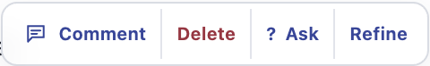
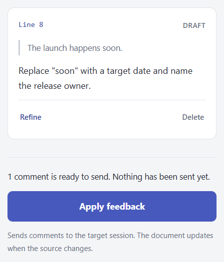
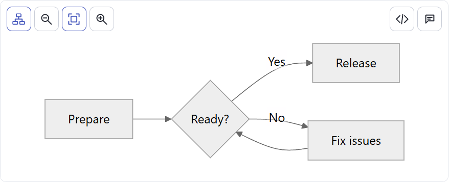

# Markdown Margin

Review Markdown in your browser, leave feedback where it belongs, and let your
agent revise the source. Margin turns document review into a simple loop:
**read, comment, apply, review again**.

## What you can do

**Leave feedback where it belongs.** Select a passage to comment, or add a
one-click **Delete** or **Refine** request.

**Review drafts before applying.** Save and edit comments, then submit them
together. The preview refreshes after your agent edits the source; existing
drafts are kept and changed source anchors can be reselected.

**Review images and diagrams too.** View local images and Mermaid diagrams,
switch to their source code, and comment on the whole image, graph, or a code
passage. Both have fit and zoom controls.

## How to use

Use the [annotate-markdown skill](skills/annotate-markdown/SKILL.md).
Node.js 22 or later is required; your agent can follow the skill's setup
instructions.

The screenshots use the fictional [release review example](examples/release-review.md),
which you can try with your agent.

1. Ask your agent: **"Use annotate-markdown to review examples/release-review.md."**
   Or use the slash command: `/annotate-markdown examples/release-review.md`.
   Replace the path with your own document when ready.
2. Open the local review link your agent provides.
3. Select text, add feedback, and save your drafts. Nothing is submitted yet.
4. Click **Apply feedback**. Your agent receives the comments and makes the
   requested edits; review the refreshed preview.
5. Choose **Finish review** when you're done.

## Privacy

The preview stays local. Keep its private review link to yourself.
Only local PNG, JPEG, GIF, and WebP images within the document folder are
displayed by default (up to 8 MiB each). For shared project images such as
`../images/diagram.png`, ask your agent to start the review with
`--image-root /absolute/path/project`. This explicitly allowed directory must
contain the document; image paths stay relative to the document and must remain
inside the allowed root, including after resolving symbolic links.
Remote images and absolute image paths remain blocked.
The browser never edits the source directly; changes go through your agent
after you submit feedback.
