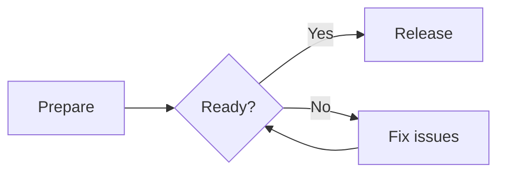

# Release review

This fictional draft demonstrates a Markdown review: clarify the launch plan,
review the workflow, and check that the release criteria are actionable.

## Launch plan

The launch happens soon.

- **Owner:** Not assigned yet.
- **Rollout:** Start with a small pilot, then expand after reviewing feedback.

## Release workflow

## Before shipping

- Complete the pilot and review its results.
- Verify that reported issues have an owner.
- Record the release decision and the next steps.
